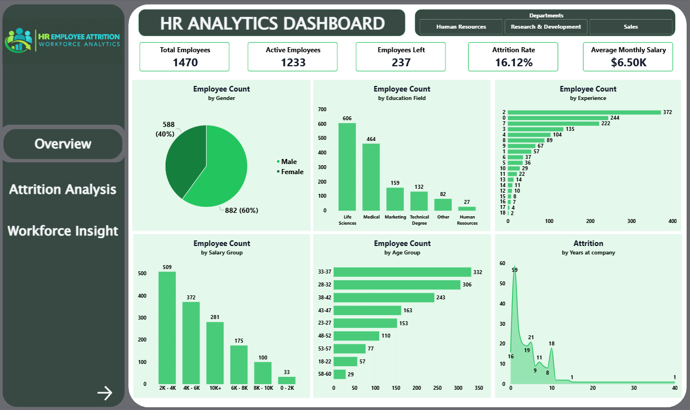
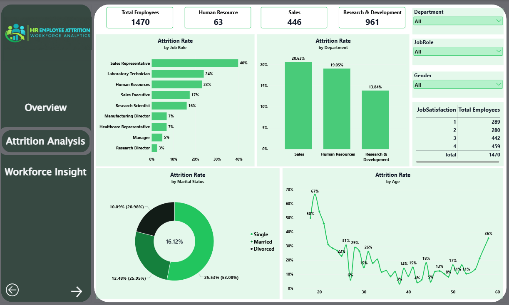
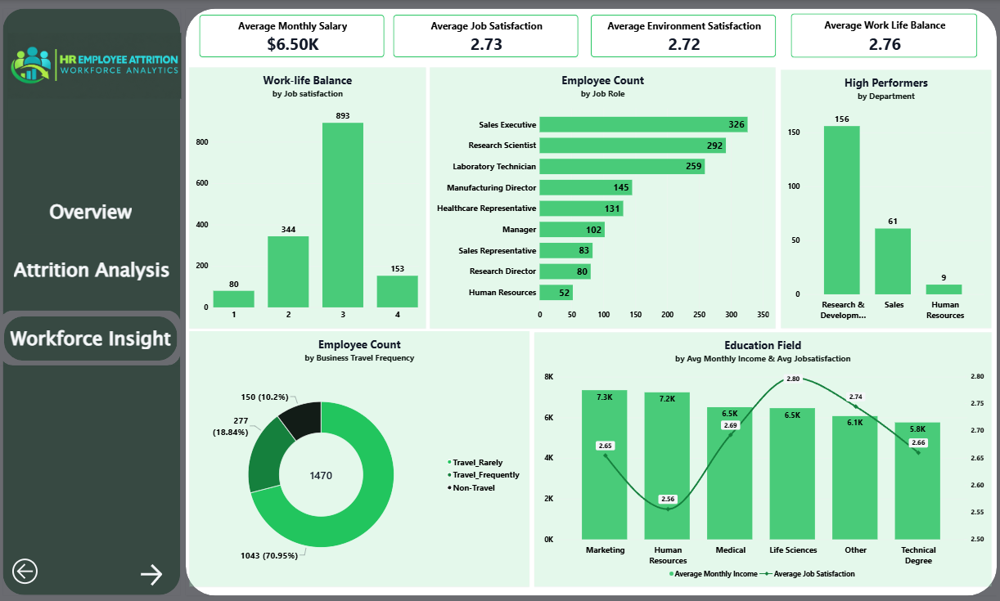

# 📊 HR Employee Attrition Analytics Dashboard

An interactive **Power BI dashboard** designed to analyze employee attrition, workforce demographics, job satisfaction, compensation, and performance ratings. This project transforms HR employee data into actionable insights through data cleaning, DAX measures, and business intelligence visualizations.

---

## 📖 Project Overview

Employee attrition can affect workforce stability, recruitment costs, and organizational knowledge. HR analytics helps organizations understand which employee groups have higher attrition rates and explore factors associated with employees leaving.

This dashboard uses the IBM HR Employee Attrition dataset to provide a centralized view of employee headcount, attrition, salary bands, satisfaction levels, tenure, departments, job roles, and performance ratings. Interactive Power BI visuals allow users to filter and compare workforce segments.

> **Dataset limitation:** The source data does not include employee joining dates or exit dates. Therefore, this project focuses on employee-level comparisons and attrition patterns, not reliable month-by-month attrition trends.

---

## 🎯 Business Objectives

- Monitor workforce size and employee attrition using key performance indicators.
- Compare attrition rates across departments, job roles, age groups, and salary bands.
- Explore relationships between attrition, overtime, job satisfaction, work-life balance, and tenure.
- Understand workforce distribution by gender, marital status, education, and job level.
- Examine performance ratings and identify outstanding-rated employees who have left.
- Support data-informed HR discussions through interactive reporting.

---

## 🛠️ Technology Stack

| Tool | Purpose |
|------|---------|
| Power BI Desktop | Dashboard development and visualization |
| Power Query | Data cleaning and transformation |
| DAX | KPI and analytical measure creation |
| CSV | Source dataset |

---

## 📂 Dataset

**Source file:** `HR-analysis.csv`

The dataset contains **1,470 employee records** and fields covering demographics, role and department, compensation, job experience, satisfaction, performance rating, and attrition status.

---

# 📊 Dashboard Pages

The following pages describe the recommended report structure for this project. Keep only the pages and visuals that are present in your final Power BI file.

## 1. HR Overview

Provides a high-level summary of employee headcount and attrition.

### KPIs

- Total Employees
- Employees Left
- Active Employees
- Attrition Rate
- Average Monthly Income
- Average Tenure

### Visualizations

- Attrition rate by department
- Employee distribution by attrition status
- Attrition rate by job role
- Employee distribution by age group
- Interactive department and gender filters

## 2. Attrition Analysis

Explores workforce groups and job-related factors associated with attrition.

### Visualizations

- Attrition rate by salary group
- Attrition rate by overtime status
- Attrition rate by age group
- Attrition rate by years at company
- Attrition rate by job satisfaction
- Attrition rate by work-life balance
- Attrition by marital status and business travel

### Interactive Filters

- Department
- Job Role
- Gender
- Age Group
- Salary Group
- OverTime
- Marital Status

## 3. Workforce & Performance Insights

Examines workforce composition and performance ratings.

### Visualizations

- Employee count by department and job role
- Average monthly income by job role
- Employee count by job level
- Performance rating distribution
- Outstanding-rated employees by department
- Outstanding-rated employees who left

In this dataset, `PerformanceRating = 4` represents **Outstanding** and `PerformanceRating = 3` represents **Excellent**. These labels reflect the dataset's rating definitions; they should not be treated as direct measurements of productivity.

---

## 📈 Key Business Questions

The dashboard helps explore questions such as:

- What proportion of employees left the company?
- Which departments and job roles have higher attrition rates?
- How does attrition vary across salary bands?
- Is attrition different for employees who work overtime?
- How do job satisfaction and work-life balance ratings vary between employees who stayed and employees who left?
- Which age groups and tenure groups show higher attrition?
- How many employees have an Outstanding performance rating?
- How many Outstanding-rated employees left the company?
- How does average monthly income differ by department and job role?

**Interpretation note:** Differences between groups show associations in this dataset. They do not, by themselves, prove that salary, overtime, satisfaction, or another factor caused attrition.

---

## ⚙️ Data Preparation & Modeling

Recommended workflow:

1. Import the CSV into Power BI Desktop.
2. Use Power Query to review column names, data types, duplicates, and missing values.
3. Confirm that employee identifiers are treated consistently and that rating fields use numeric types.
4. Create calculated columns for useful groups such as age bands and salary bands.
5. Create DAX measures for headcount, attrition, income, tenure, and performance analysis.
6. Build report visuals and configure slicers and cross-filtering.
7. Validate KPI totals against the source data before publishing.

This is a single employee-level source table, so a multi-table star schema is not required unless the project is extended with additional datasets.

---

## 📊 Features

- Interactive KPI cards
- Department and job-role comparisons
- Salary-band and age-group analysis
- Satisfaction and overtime analysis
- Performance-rating analysis
- Dynamic slicers and cross-filtering
- Drill-down exploration where configured
- Consistent dashboard theme and layout
- DAX-based measures for reusable calculations

---

## 🧠 Key Findings to Investigate

Use the completed dashboard to validate findings such as:

- Whether attrition rates differ by department or job role.
- Whether employees working overtime show a different attrition rate.
- Whether lower satisfaction ratings are associated with higher attrition.
- Whether attrition varies by salary group or tenure.
- Whether outstanding-rated employees have left, and which teams they belonged to.

Record numerical findings only after validating them in the final Power BI report. Avoid presenting correlations as causal conclusions.

---

## 📷 Dashboard Screenshots

Add screenshots of your completed report and update the filenames below to match the images committed to your repository.

### HR Overview

### Attrition Analysis

### Workforce & Performance Insights

---

## 💼 Skills Demonstrated

- Data cleaning and transformation
- Power Query
- DAX measures and calculated columns
- KPI development
- Employee attrition analysis
- Workforce and compensation analysis
- Performance-rating analysis
- Data visualization and dashboard design
- Interactive reporting
- Business-focused insight communication

---

## 🚀 Project Highlights

- HR-focused Power BI analytics project
- Employee-level attrition analysis
- Salary-band and demographic comparisons
- Satisfaction, overtime, and tenure analysis
- Performance-rating and high-performer attrition measures
- Interactive report filtering
- Business-oriented KPI reporting

---

## 🎯 Future Enhancements

- Add reliable joining and exit dates to support monthly attrition trends.
- Add recruitment, training, and employee engagement datasets.
- Develop a more detailed retention analysis by job role and tenure.
- Add drill-through pages for department-level investigation.
- Add a documented data dictionary and KPI definitions.
- Explore predictive attrition modeling only with suitable validation data and careful interpretation.

---

## 👤 Author

**Giridharan M**

**Aspiring Data Analyst | Power BI | SQL | Python | Excel**

If you find this project useful, feel free to ⭐ the repository and connect with me on LinkedIn.
